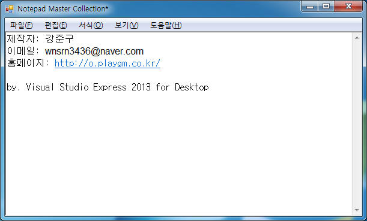

# Notepad Master Collection

[한국어](README.ko.md)

A text editor modeled on Windows Notepad. The File, Edit, Format, View, and Help menus match Notepad down to each item's name and shortcut key, and every time a menu opens, its items are enabled or disabled based on the current state. The editing area is a RichTextBox, and files are read and written as text in the system default encoding. It was made as a school assignment.

<p>
  
</p>


## How to use

Download it from Releases and run it. It requires .NET Framework 4.5.

| Menu | Shortcut | Action |
|---|---|---|
| File > New | Ctrl+N | Starts a blank document |
| File > Open | Ctrl+O | Opens a text file |
| File > Save | Ctrl+S | Overwrites the opened file. For a new document it works like Save As |
| File > Save As | | Saves to a chosen location |
| Edit > Undo, Cut, Copy, Paste | Ctrl+Z, Ctrl+X, Ctrl+C, Ctrl+V | Same as Notepad |
| Edit > Delete | Del | Deletes the selected text |
| Edit > Find, Find Next | Ctrl+F, F3 | Opens the Find window or searches again for the last search term |
| Edit > Select All | Ctrl+A | Selects the whole text |
| Edit > Time/Date | F5 | Adds the current time and date to the end of the document |
| Format > Word Wrap, Font | | Toggles word wrap or changes the font |
| Help > View Help, About Notepad | | Shows Windows Help and the program information |

Editing the text adds `*` to the end of the window title bar. If you start a new document, open a file, exit, or close the window with unsaved edits, the program asks "변경 내용을 저장하시겠습니까?" (save changes?), and answering "예" (yes) opens a dialog for choosing where to save.

In the Find window, type the text and press Enter or "다음 찾기" (find next) to select its first occurrence after the cursor. Esc closes the window.


## How it works

**Menu states are computed every time a menu opens.** Each menu's `DropDownOpening` calls `MyEnabled`, which enables or disables the items. Undo follows `CanUndo`; Cut, Copy, and Delete follow the selection; Paste follows whether the clipboard holds text; and Find follows whether there is any text. Notepad also grays out menu items depending on the situation, and this copies that behavior.

```vb
실행취소UToolStripMenuItem.Enabled = richNotepad.CanUndo
잘라내기TToolStripMenuItem.Enabled = richNotepad.SelectedText <> ""
복사CToolStripMenuItem.Enabled = richNotepad.SelectedText <> ""
붙여넣기PToolStripMenuItem.Enabled = richNotepad.CanPaste(DataFormats.GetFormat(DataFormats.Text))
삭제LToolStripMenuItem.Enabled = richNotepad.SelectedText <> ""
찾기FToolStripMenuItem.Enabled = richNotepad.Text <> ""
```

**The edited state is tracked with three values.** `TextChanged` also fires when a loaded file fills in the text, so the state is set to `OpenFile` just before opening and that one event is skipped. The first change after that switches it to `Edited` and adds `*` to the title, and saving returns it to `NotEdited`.

```vb
Private Sub richNotepad_TextChanged(sender As Object, e As EventArgs) Handles richNotepad.TextChanged
    If IsEdited = MyEdited.OpenFile Then
        IsEdited = MyEdited.NotEdited
    ElseIf IsEdited <> MyEdited.Edited Then
        IsEdited = MyEdited.Edited
        Me.Text &= "*"
    End If
End Sub
```


## Files

| Path | Content |
|---|---|
| `source/Notepad_Master_Collection.sln` | Visual Studio 2013 solution |
| `source/Notepad_Master_Collection/FormNotepad.vb` | Menu actions, file reading and writing, menu states |
| `source/Notepad_Master_Collection/FormNotepad.Designer.vb` | Menu and editing area design |
| `source/Notepad_Master_Collection/FormSearch.vb` | Find window |
| `source/Notepad_Master_Collection/Resources/menu.png` | Menu bar background |
| `docs/screenshots/` | Screenshots |
| Releases | Executable |


## License

zlib. See [LICENSE](LICENSE).
